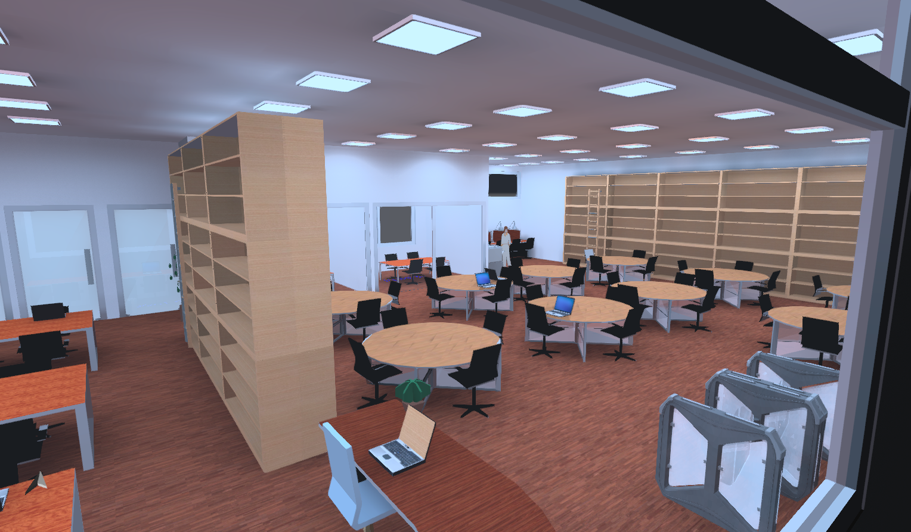

# Library Interior and Lighting Design — DIALux evo

A 3D library interior and lighting layout modeled in DIALux evo. The design includes reading tables, shelving, computer work areas, enclosed study rooms, and a coordinated ceiling luminaire layout.

## Project files

- [Download the DIALux evo project archive](https://github.com/lithiumvision/dialux-library-lighting-design/releases/latest/download/library-lighting-design.zip) — extract the ZIP to access the editable `.evo` file, then open it with DIALux evo.
- [Walkthrough 1](walkthrough-01.mp4)
- [Walkthrough 2](walkthrough-02.mp4)
- [Interior preview](library-interior.png)

## Scope

This repository documents the 3D model and lighting arrangement available in the provided project files. The supplied materials do not include a photometric calculation report, luminaire schedule, or numerical illuminance results, so no lighting-performance or standards-compliance claim is made here.

## Software

- DIALux evo

## Notes

This is a simulation and design model; it does not document an installed lighting system. Product names, photometric data, dimensions, and design assumptions should be checked in the DIALux project before using the design for construction or compliance purposes.
